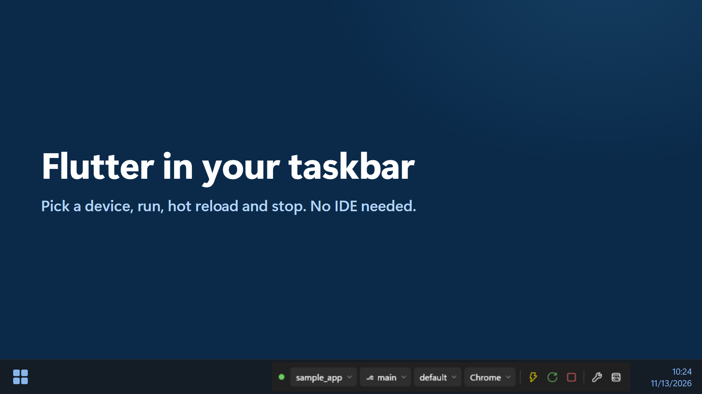
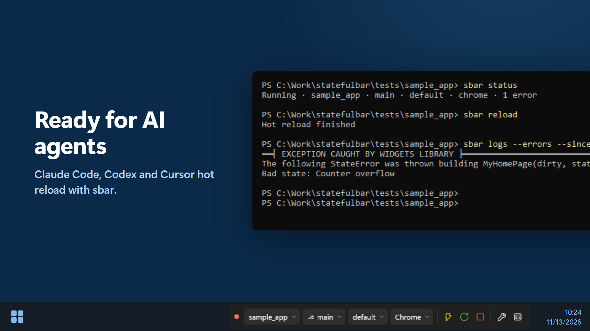
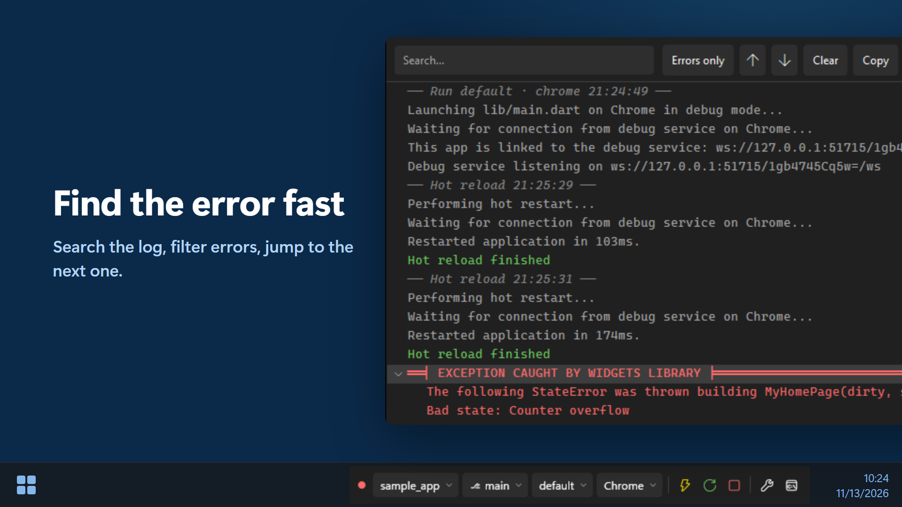
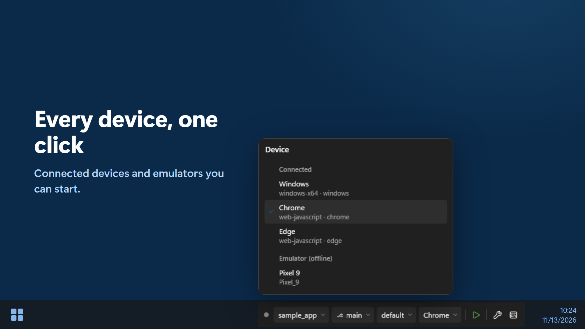
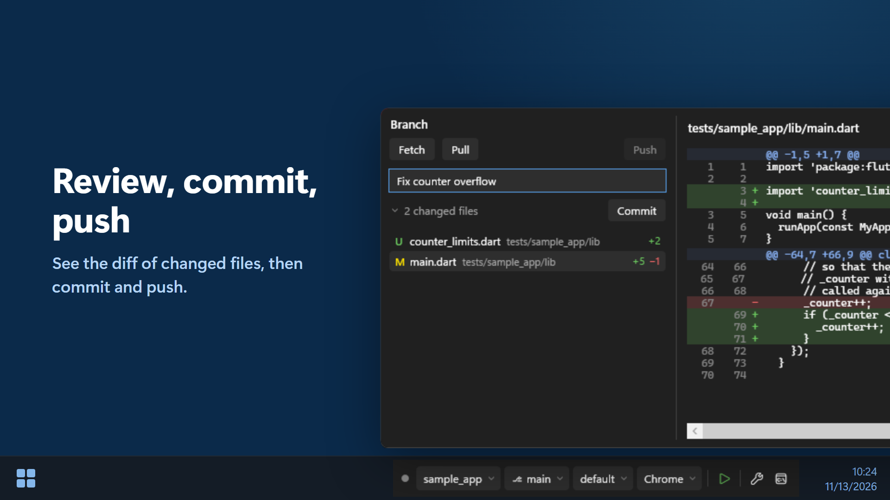
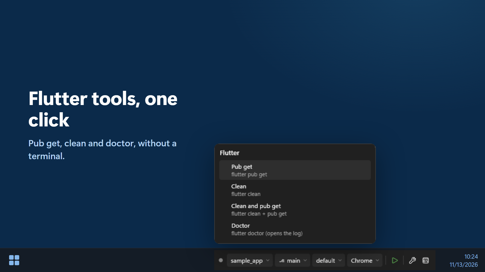
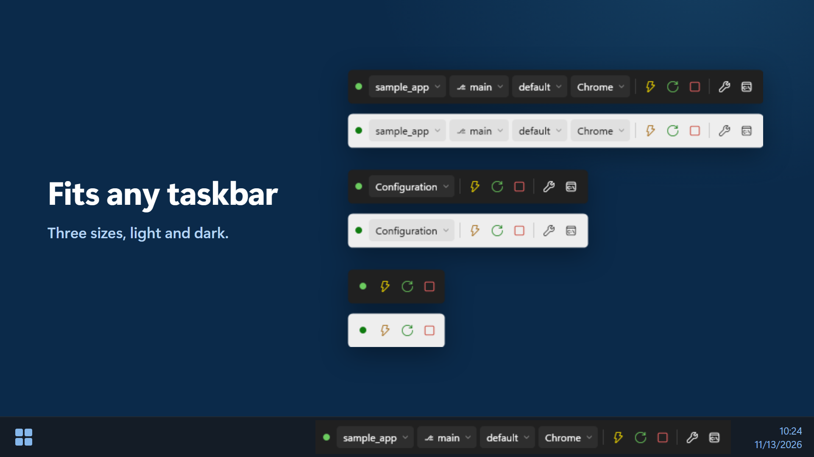
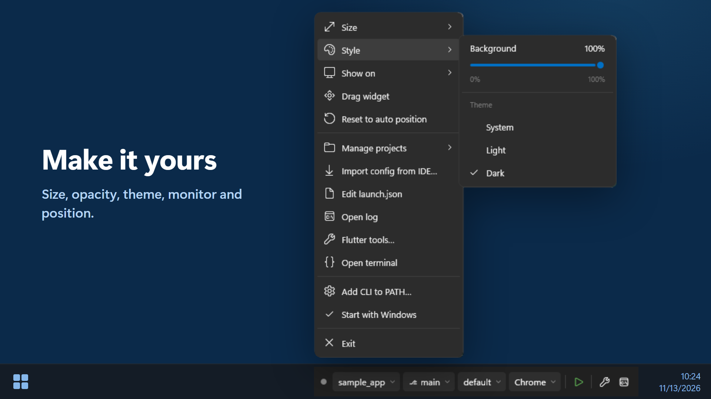

# StatefulBar

Bahasa Indonesia: [docs/README.id.md](docs/README.id.md)

StatefulBar is a Windows taskbar widget that replaces Android Studio's run toolbar for Flutter projects: pick a device,
run, hot reload, and stop without opening the IDE.



## Contents

- [Features](#features)
- [Screenshots](#screenshots)
- [Requirements](#requirements)
- [Install](#install)
- [Getting started](#getting-started)
- [Widget menu](#widget-menu)
- [Git actions](#git-actions)
- [Run configurations](#run-configurations)
- [CLI](#cli)
- [Using with AI agents](#using-with-ai-agents)
- [Uninstall](#uninstall)
- [Limitations](#limitations)
- [Building from source](#building-from-source)
- [License](#license)
- [Trademarks](#trademarks)

## Features

- Docks into the Windows 10 and 11 taskbar, on any monitor, in three sizes (Full, Compact, Buttons only), with light and
  dark themes.
- Pick the project, git branch, run configuration, and device from chips on the widget, then Run, Hot reload, Hot restart,
  and Stop.
- Starts Android emulators from the device list.
- Imports run configurations from Android Studio and VS Code.
- Runs projects through fvm when they use it.
- Flutter tools in one click: pub get, clean, build_runner, doctor.
- Git from the branch flyout: fetch, pull, push, commit, switch branch, and a diff of the changed files.
- A log window with search, an errors-only filter, and jump to the next error.
- The `sbar` command line tool lets terminals and AI agents (Claude Code, Codex, Cursor, …) hot reload and read errors.

## Screenshots

Click a picture to see it at full size.

<p align="center">
  
  
  
  
  
  
  
</p>

## Requirements

- Windows 10 or 11, 64-bit (x64). No .NET install needed.
- The Flutter SDK on PATH, or fvm for projects that use it.
- Optional: git (branch chip and git actions) and the Android SDK platform-tools (`adb`) for Android devices and emulators.

## Install

Download from the [Releases](https://github.com/andrehaliim/statefulbar/releases) page:

- **`StatefulBar-<version>-win-x64-setup.exe`** (recommended). Installs for your account only, no admin rights needed, to
  `%LOCALAPPDATA%\Programs\StatefulBar`. Options, all checked by default: Start with Windows, Add the sbar CLI to PATH,
  desktop shortcut, and launch after install.
- **`StatefulBar-<version>-win-x64.zip`** (portable). Extract it anywhere and run `StatefulBar\StatefulBar.exe`. Use the
  right-click menu for "Start with Windows" and "Add CLI to PATH…".

The installer isn't code-signed yet, so Windows SmartScreen may show "Windows protected your PC": click **More info** >
**Run anyway**.

To update, run the newer `Setup.exe`; it closes the running widget first. Your settings are kept.

## Getting started

1. Run StatefulBar. The widget docks in the taskbar, left of the tray/clock area. If the automatic position doesn't fit
   (e.g. next to a third-party taskbar widget such as TrafficMonitor, which automatic detection can't see), right-click >
   "Drag widget".
2. Tell StatefulBar where your Flutter projects are: in the project flyout, "Add root folder…" adds a folder that holds
   your projects (e.g. `C:\Work`) and "Add project…" adds a single project. The same lists are under right-click >
   Manage projects. The scan looks 3 levels deep for Flutter `pubspec.yaml` files.
3. Pick the project, branch, config, and device with the widget's chips, then press ▶.
4. Project has no run configuration yet? In the config flyout choose "Import from IDE" (reads Android Studio run
   configurations from `.idea/workspace.xml` and `.run/*.xml`, and `.vscode/launch.json`) or "Create default".
5. Optional: right-click > "Add CLI to PATH…" so `sbar` works in new terminals, and "Start with Windows".

Projects that use fvm (`.fvmrc` or `.fvm/fvm_config.json`) always run through `fvm flutter`, with no fallback to the global flutter.

## Widget menu

Right-click the widget:

- **Size**: Full (all chips), Compact (one `Configuration ▾` chip that opens a combined flyout), or Buttons only
  (click the status dot for the combined flyout). Sizes that don't fit the free taskbar space are disabled with a note;
  when the taskbar fills up, the widget steps down a size on its own and returns to the chosen size once there is room again.
- **Style**: a 0–100% background opacity slider (chips, icons, and text stay fully opaque) and Theme System / Light / Dark.
  System follows the Windows taskbar theme; Light/Dark lock every StatefulBar window.
- **Show on**: move to another monitor's taskbar (needs "Show my taskbar on all displays"). There is only one widget, never
  duplicated. When that monitor is unplugged the widget moves to the main taskbar, and comes back when it is plugged in again.
- **Drag widget** / **Reset to auto position**: move the widget horizontally; the position is saved.
- **Manage projects**, **Import config from IDE…**, **Edit launch.json**, **Open log**, **Flutter tools…**, **Open terminal**,
  **Add CLI to PATH…**, **Start with Windows**, **Exit**.

Widget buttons:

- **Wrench** (Flutter tools; Full/Compact; in Buttons only via the menu > Flutter tools…): Pub get, Clean, Clean and pub get,
  Run build_runner (only when `build_runner` is in the pubspec), and Doctor. One command at a time, cancellable, output goes
  to the log. Clean is disabled while the app runs; ▶ waits until the command finishes.
- **Log button** (rightmost): a menu with Open log and Open terminal (Windows Terminal when available, otherwise PowerShell,
  in the project folder).

## Git actions

Click the branch chip: `Fetch` (`git fetch --prune`), `Pull` (plain `git pull`), and `Push` on the right; a `Commit message`
box + `Commit`; the changed-file count; and the branch list.

- `Commit` runs `git add -A` for the WHOLE repo (not just the project folder; in a monorepo, changes outside the project are
  committed too), then `git commit`. It doesn't push.
- `Push ↑N` sends the unpushed commits (`push -u origin <branch>` when there is no upstream yet, which also publishes a new
  branch). It's disabled when there is nothing to push.
- Click `N changed files` to review before committing: the flyout widens, the changed files replace the branch list, and the
  selected file's diff against HEAD (staged and unstaged together, so exactly what `Commit` records) shows on the right.
  Read-only: nothing is staged or discarded there. Binary files and files with more than 5,000 changed lines aren't shown.
- Never `--force`, no automatic pull before push; a rejected push suggests "Pull first.". An unfinished merge/rebase and a
  detached HEAD are refused.
- HTTPS remotes sign in through Git Credential Manager (never waits for terminal input; 2 minute limit). SSH remotes that need
  a passphrase or a new host key must be set up from a terminal first (ssh-agent / one `ssh` run).
- Results show inside the flyout while it is open (a toast only once the flyout is closed); long git output is cut to about
  6 lines, the full text is in `%APPDATA%\StatefulBar\diag.log`.

## Run configurations

Each project keeps its run configurations in `<project>\.statefulbar\launch.json`, in JSONC format (comments and trailing
commas allowed). The file is read again from disk every time it is used, so edits apply on the next ▶.

```jsonc
{
  "version": 1,
  "configurations": [
    {
      "name": "beta",                 // required, unique per file
      "program": "lib/main.dart",     // optional, default "lib/main.dart", relative to the project root
      "flavor": "beta",               // optional, becomes --flavor beta
      "mode": "debug",                // optional: debug | profile | release, default debug
      "args": [                       // optional, one element = one argument
        "--dart-define=mode=debug",
        "--dart-define=API_SERVER=https://beta.api.example.com/",
        "--dart-define=APP_NAME=My App Beta"
      ]
    }
  ]
}
```

The command that runs (working directory = project root):
`<flutter> run --machine -d <deviceId> -t <program> [--flavor <flavor>] --<mode> <args...>`

## CLI

StatefulBar must be running; the CLI talks to it over a named pipe owned by the current user.

```
sbar status
sbar reload
sbar restart
sbar stop
sbar logs [--errors] [--tail N] [--since-last-reload]
```

Every command supports `--json`. There is no `sbar run` on purpose: start the app with the ▶ button.

| Exit code | Meaning |
|---|---|
| 0 | OK |
| 1 | Failed (e.g. reload failed to compile, "Reload in progress", session Failed) |
| 2 | StatefulBar is not running |
| 3 | No active session |
| 4 | Timeout (reload/restart took longer than 60 seconds) |
| 64 | Usage error (unknown command or argument) |

## Using with AI agents

Agents (Claude Code, Codex, Cursor, …) don't know that your app is run by StatefulBar: without a hint they try `flutter run`,
`flutter attach`, or the Dart MCP `launch_app`, and start a second app. Paste the snippet below once into `CLAUDE.md` or
`AGENTS.md` at the root of your Flutter project, or into your agent's global instructions file (e.g. `~/.claude/CLAUDE.md`).
`sbar` must be on PATH (the installer's "Add the sbar CLI to PATH" option, or the "Add CLI to PATH…" menu item).

```markdown
## Running app (StatefulBar)

The Flutter app is started and owned by the StatefulBar taskbar widget, not by a terminal or the IDE.
Control it with the `sbar` CLI; do not run `flutter run`, `flutter attach`, or Dart MCP `launch_app` for it.

- After editing Dart code: `sbar reload` (use `sbar restart` after changes to `main()`, `initState`,
  globals, or enums), then `sbar logs --errors --since-last-reload` and fix any errors.
- `sbar status` shows whether an app is running, and on which project, config, and device.
- Exit codes: 0 OK, 1 failed (e.g. compile error, message on stderr), 2 StatefulBar not running,
  3 no running app (ask the user to press Run in the widget), 4 timeout.
- Add `--json` for machine-readable output.
```

From then on the agent runs `sbar reload` and reads the errors itself every time it finishes editing Dart code. When no app
is running it gets exit code 3 and asks you to press ▶.

## Uninstall

Settings > Apps > StatefulBar > Uninstall. This closes the widget and removes its files, shortcuts, the Start with Windows
entry, and the PATH entry. You're then asked whether to also remove your settings and logs (`%APPDATA%\StatefulBar`); the
default is No, so a reinstall keeps your projects and choices.

For the portable zip: turn off "Start with Windows" in the menu if you used it, right-click > Exit, then delete the folder.
If you used "Add CLI to PATH…", also remove that folder from your user PATH (Start > "Edit environment variables for your
account" > Path > Edit).

## Limitations

- Arguments in `launch.json` that contain a double quote (`"`) are rejected (there is no escaping that survives both cmd.exe
  and `flutter.bat`). Use `--dart-define-from-file` for complex values.
- Automatic placement can't see third-party taskbar widgets (e.g. TrafficMonitor); use "Drag widget".
- The widget hides while a fullscreen app (game, video) runs.
- With an auto-hiding taskbar, the widget hides/shows slightly later than the taskbar animation.
- git and adb are detected only when StatefulBar starts; after installing them, restart StatefulBar.
- Idle memory use is about 30–40 MB (the "Memory" column in Task Manager).

## Building from source

See [docs/DEVELOPMENT.md](docs/DEVELOPMENT.md) for building, testing, and packaging StatefulBar.

## License

MIT, see [LICENSE](LICENSE).

## Trademarks

Flutter and the related logo are trademarks of Google LLC. StatefulBar is an independent project and is not affiliated with,
sponsored by, or endorsed by Google.
