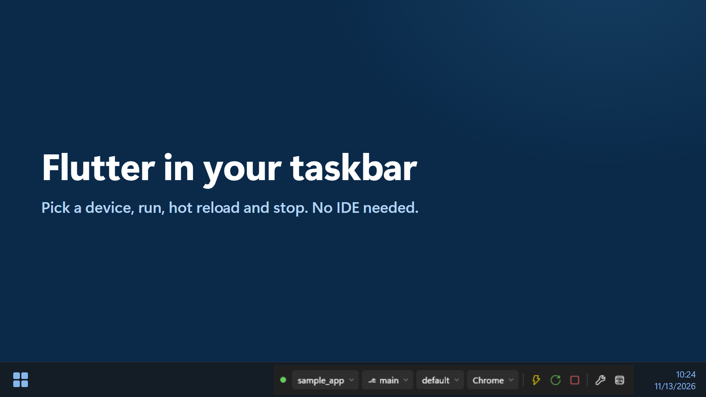
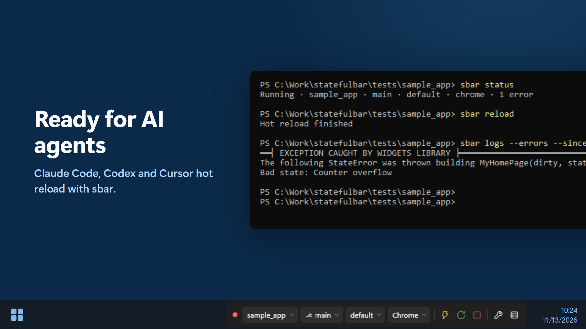
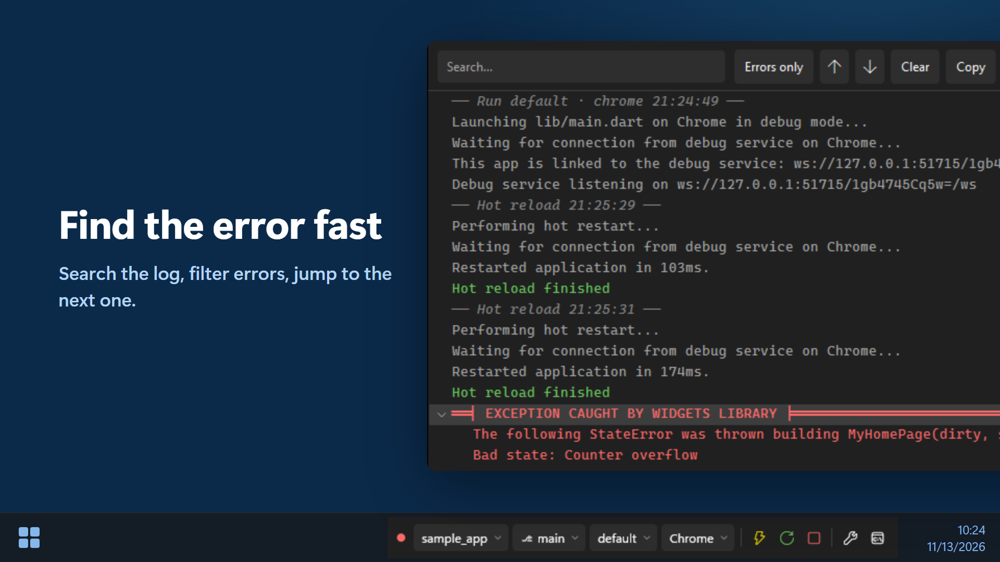
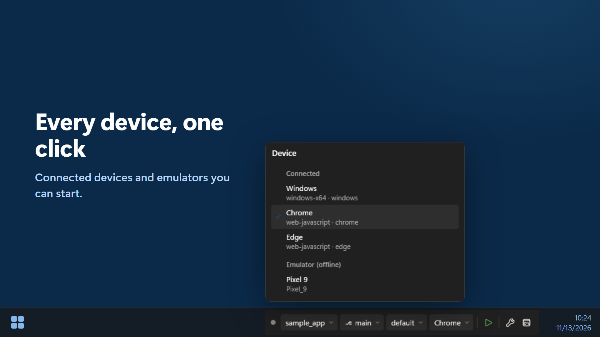
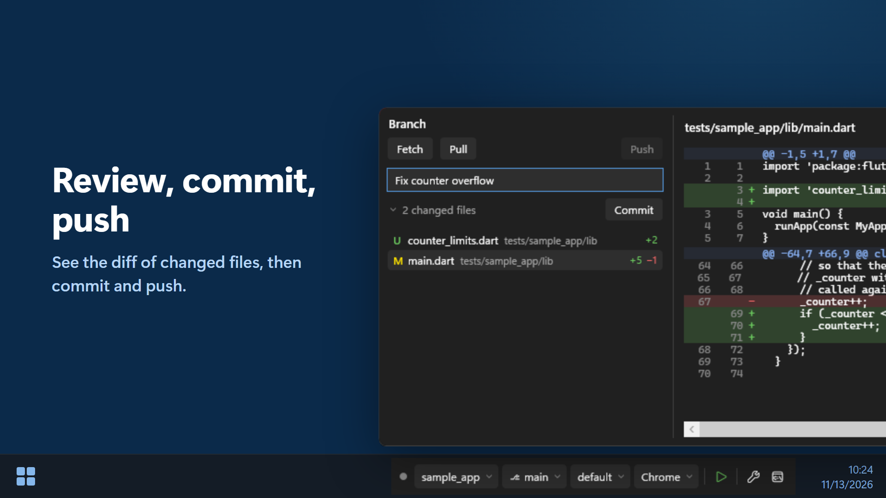
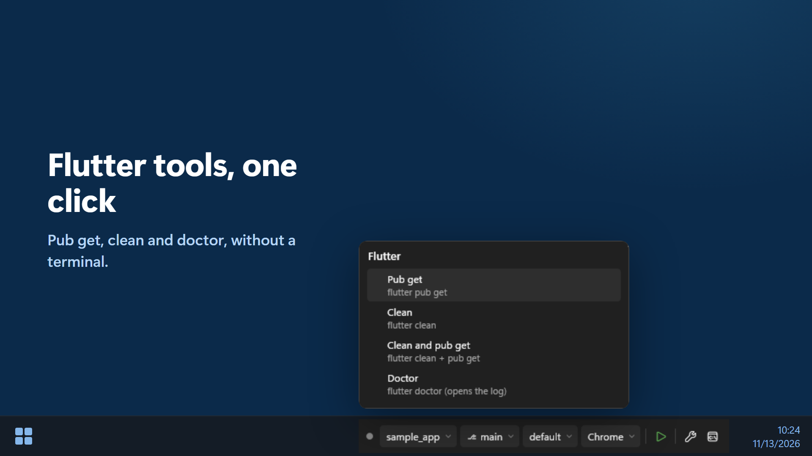
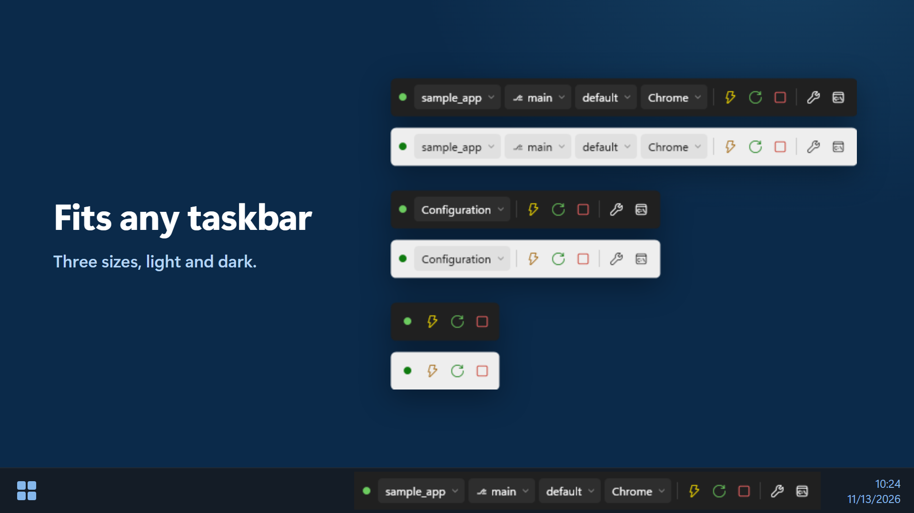
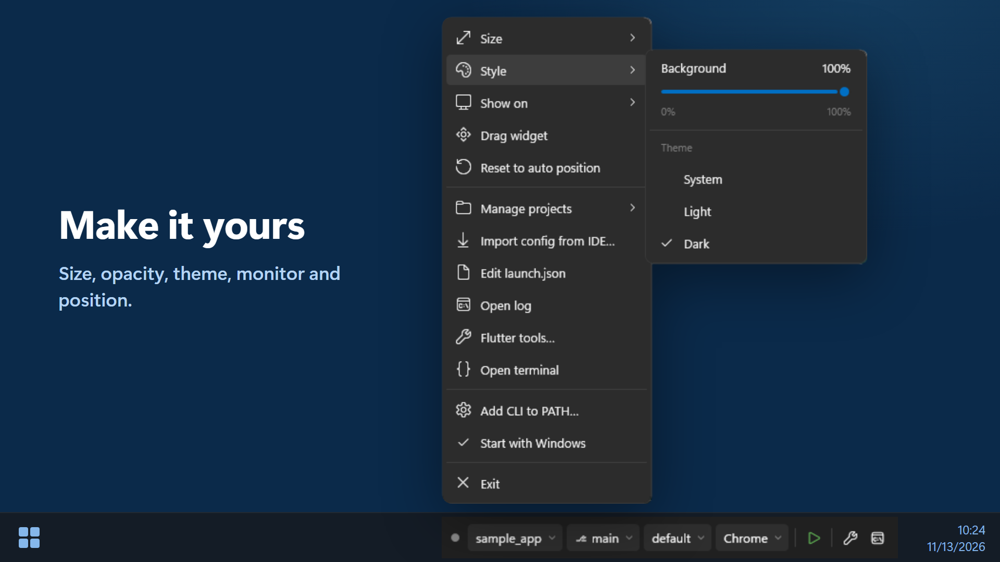

# StatefulBar

English: [README.md](../README.md)

StatefulBar adalah widget taskbar Windows yang menggantikan run toolbar Android Studio untuk project Flutter: pilih device,
run, hot reload, dan stop tanpa membuka IDE.



## Daftar isi

- [Fitur](#fitur)
- [Tangkapan layar](#tangkapan-layar)
- [Kebutuhan sistem](#kebutuhan-sistem)
- [Instalasi](#instalasi)
- [Pertama kali dipakai](#pertama-kali-dipakai)
- [Menu widget](#menu-widget)
- [Aksi git](#aksi-git)
- [Run configuration](#run-configuration)
- [CLI](#cli)
- [Dipakai bersama AI agent](#dipakai-bersama-ai-agent)
- [Uninstall](#uninstall)
- [Keterbatasan](#keterbatasan)
- [Build dari source](#build-dari-source)
- [Privasi](#privasi)
- [Lisensi](#lisensi)
- [Merek dagang](#merek-dagang)

## Fitur

- Menempel di taskbar Windows 10 dan 11, di monitor mana pun, dalam tiga ukuran (Full, Compact, Buttons only), dengan tema
  terang dan gelap.
- Pilih project, branch git, run configuration, dan device lewat chip di widget, lalu Run, Hot reload, Hot restart, dan Stop.
- Menyalakan emulator Android dari daftar device.
- Mengimpor run configuration dari Android Studio dan VS Code.
- Menjalankan project lewat fvm bila project memakainya.
- Flutter tools sekali klik: pub get, clean, build_runner, doctor.
- Git dari flyout branch: fetch, pull, push, commit, pindah branch, dan diff file yang berubah.
- Jendela log dengan pencarian, filter khusus error, dan lompat ke error berikutnya.
- Tool command line `sbar` membuat terminal dan AI agent (Claude Code, Codex, Cursor, …) bisa hot reload dan membaca error.

## Tangkapan layar

Klik gambar untuk melihat ukuran penuhnya.

<p align="center">
  
  
  
  
  
  
  
</p>

## Kebutuhan sistem

- Windows 10 atau 11, 64-bit (x64). Tidak perlu memasang .NET.
- Flutter SDK di PATH, atau fvm untuk project yang memakainya.
- Opsional: git (chip branch dan aksi git) serta Android SDK platform-tools (`adb`) untuk device dan emulator Android.

## Instalasi

Unduh dari halaman [Releases](https://github.com/andrehaliim/statefulbar/releases):

- **`StatefulBar-<versi>-win-x64-setup.exe`** (disarankan). Menginstal hanya untuk akun Anda, tanpa hak admin, ke
  `%LOCALAPPDATA%\Programs\StatefulBar`. Pilihan yang semuanya tercentang default: Start with Windows, Add the sbar CLI to
  PATH, shortcut desktop, dan jalankan setelah install.
- **`StatefulBar-<versi>-win-x64.zip`** (portable). Ekstrak di mana saja lalu jalankan `StatefulBar\StatefulBar.exe`. Pakai
  menu klik kanan untuk "Start with Windows" dan "Add CLI to PATH…".

Installer belum ditandatangani (code signing), jadi Windows SmartScreen bisa menampilkan "Windows protected your PC": klik
**More info** > **Run anyway**.

Untuk update, jalankan `Setup.exe` versi yang lebih baru; widget yang sedang berjalan ditutup dulu. Setelan Anda tetap ada.

## Pertama kali dipakai

1. Jalankan StatefulBar. Widget menempel di taskbar, di kiri area tray/jam. Kalau posisi otomatis tidak cocok (mis. di
   sebelah widget taskbar pihak ketiga seperti TrafficMonitor, yang tidak terlihat oleh deteksi otomatis), klik kanan >
   "Drag widget".
2. Beri tahu StatefulBar di mana project Flutter Anda: di flyout project, "Add root folder…" menambah folder yang berisi
   project-project Anda (mis. `C:\Work`) dan "Add project…" menambah satu project. Daftar yang sama ada di klik kanan >
   Manage projects. Scan sedalam 3 tingkat mencari `pubspec.yaml` Flutter.
3. Pilih project, branch, config, dan device lewat chip di widget, lalu tekan ▶.
4. Project belum punya run configuration? Di flyout config pilih "Import from IDE" (membaca run configuration Android Studio
   dari `.idea/workspace.xml` dan `.run/*.xml`, serta `.vscode/launch.json`) atau "Create default".
5. Opsional: klik kanan > "Add CLI to PATH…" agar `sbar` bisa dipanggil dari terminal baru, dan "Start with Windows".

Project yang memakai fvm (`.fvmrc` atau `.fvm/fvm_config.json`) selalu dijalankan lewat `fvm flutter`, tanpa fallback ke flutter global.

## Menu widget

Klik kanan widget:

- **Size**: Full (semua chip), Compact (satu chip `Configuration ▾` yang membuka flyout gabungan), atau Buttons only
  (klik titik status untuk flyout gabungan). Ukuran yang tidak muat di area kosong taskbar dinonaktifkan dengan catatan;
  kalau taskbar penuh, widget turun ukuran sendiri dan kembali ke ukuran pilihan saat ruang cukup lagi.
- **Style**: slider opacity latar widget 0–100% (chip, ikon, dan teks tetap penuh) dan Theme System / Light / Dark.
  System mengikuti tema taskbar Windows; Light/Dark mengunci semua jendela StatefulBar.
- **Show on**: pindah ke taskbar monitor lain (butuh "Show my taskbar on all displays"). Satu widget saja, tidak
  diduplikasi. Bila monitor itu dicabut, widget pindah ke taskbar utama dan kembali saat monitor dicolok lagi.
- **Drag widget** / **Reset to auto position**: geser widget secara horizontal; posisinya disimpan.
- **Updates**: "Check now" menanyakan ke GitHub apakah ada rilis yang lebih baru dan menjawab lewat toast; tombol
  "View release" di toast itu membuka halaman rilis di browser. Selama "Check automatically" menyala (bawaan), StatefulBar
  bertanya sekali sehari dan memberi tahu satu kali untuk tiap versi baru. Tidak ada yang diunduh atau dipasang.
- **Manage projects**, **Import config from IDE…**, **Edit launch.json**, **Open log**, **Flutter tools…**, **Open terminal**,
  **Add CLI to PATH…**, **Start with Windows**, **Exit**.

Tombol di widget:

- **Kunci pas** (Flutter tools; Full/Compact; di Buttons only lewat menu > Flutter tools…): Pub get, Clean, Clean and pub get,
  Run build_runner (hanya bila `build_runner` ada di pubspec), dan Doctor. Satu perintah sekaligus, bisa di-Cancel, output masuk
  ke log. Clean nonaktif selama app berjalan; ▶ menunggu sampai perintah selesai.
- **Tombol log** (paling kanan): menu Open log dan Open terminal (Windows Terminal bila ada, selain itu PowerShell,
  di folder project).

## Aksi git

Klik chip branch: `Fetch` (`git fetch --prune`), `Pull` (`git pull` biasa), dan `Push` di kanan; kolom `Commit message` +
`Commit`; jumlah file yang berubah; dan daftar branch.

- `Commit` menjalankan `git add -A` untuk SELURUH repo (bukan hanya folder project; di monorepo perubahan di luar project ikut
  ter-commit), lalu `git commit`. Tidak melakukan push.
- `Push ↑N` mengirim commit yang belum terkirim (`push -u origin <branch>` bila belum ada upstream, sekaligus mempublikasikan
  branch baru). Tombolnya nonaktif bila tidak ada yang perlu dikirim.
- Klik `N changed files` untuk memeriksa sebelum commit: flyout melebar, daftar file yang berubah menggantikan daftar branch,
  dan diff file terpilih terhadap HEAD (staged dan unstaged sekaligus, jadi persis yang direkam `Commit`) tampil di kanan.
  Hanya-baca: tidak ada stage atau discard di sana. File biner dan file dengan lebih dari 5.000 baris berubah tidak ditampilkan.
- Tidak pernah `--force`, tidak ada pull otomatis sebelum push; push ditolak = saran "Pull first.". Merge/rebase yang belum
  selesai dan HEAD detached ditolak.
- Login remote HTTPS lewat Git Credential Manager (tidak pernah menunggu input terminal; batas 2 menit). Remote SSH yang butuh
  passphrase atau host baru harus disiapkan dulu dari terminal (ssh-agent / sekali `ssh`).
- Hasil tampil di dalam flyout selama terbuka (toast hanya bila flyout sudah tertutup); output git panjang dipotong ~6 baris,
  teks lengkap di `%APPDATA%\StatefulBar\diag.log`.

## Run configuration

Setiap project menyimpan run configuration-nya di `<project>\.statefulbar\launch.json`, format JSONC (komentar dan trailing
comma boleh). File dibaca ulang dari disk setiap kali dipakai, jadi perubahan langsung berlaku pada ▶ berikutnya.

```jsonc
{
  "version": 1,
  "configurations": [
    {
      "name": "beta",                 // wajib, unik per file
      "program": "lib/main.dart",     // opsional, default "lib/main.dart", relatif ke root project
      "flavor": "beta",               // opsional, menjadi --flavor beta
      "mode": "debug",                // opsional: debug | profile | release, default debug
      "args": [                       // opsional, satu elemen = satu argumen
        "--dart-define=mode=debug",
        "--dart-define=API_SERVER=https://beta.api.example.com/",
        "--dart-define=APP_NAME=My App Beta"
      ]
    }
  ]
}
```

Perintah yang dijalankan (working directory = root project):
`<flutter> run --machine -d <deviceId> -t <program> [--flavor <flavor>] --<mode> <args...>`

## CLI

StatefulBar harus sedang berjalan; CLI bicara lewat named pipe milik user saat ini.

```
sbar status
sbar reload
sbar restart
sbar stop
sbar logs [--errors] [--tail N] [--since-last-reload]
```

Semua perintah mendukung `--json`. `sbar run` sengaja tidak ada: jalankan app lewat tombol ▶.

| Exit code | Arti |
|---|---|
| 0 | OK |
| 1 | Gagal (mis. reload gagal compile, "Reload in progress", sesi Failed) |
| 2 | StatefulBar tidak berjalan |
| 3 | Tidak ada sesi aktif |
| 4 | Timeout (reload/restart lebih dari 60 detik) |
| 64 | Pemakaian salah (perintah/argumen tidak dikenal) |

## Dipakai bersama AI agent

Agent (Claude Code, Codex, Cursor, …) tidak otomatis tahu bahwa app Anda dijalankan oleh StatefulBar: tanpa petunjuk, agent
mencoba `flutter run`, `flutter attach`, atau Dart MCP `launch_app` dan menyalakan app kedua. Tempel potongan di bawah sekali
ke `CLAUDE.md` atau `AGENTS.md` di root project Flutter, atau ke file instruksi global agent Anda (mis. `~/.claude/CLAUDE.md`).
Syaratnya `sbar` ada di PATH (opsi "Add the sbar CLI to PATH" di installer, atau menu "Add CLI to PATH…").

```markdown
## Running app (StatefulBar)

The Flutter app is started and owned by the StatefulBar taskbar widget, not by a terminal or the IDE.
Control it with the `sbar` CLI; do not run `flutter run`, `flutter attach`, or Dart MCP `launch_app` for it.

- After editing Dart code: `sbar reload` (use `sbar restart` after changes to `main()`, `initState`,
  globals, or enums), then `sbar logs --errors --since-last-reload` and fix any errors.
- `sbar status` shows whether an app is running, and on which project, config, and device.
- Exit codes: 0 OK, 1 failed (e.g. compile error, message on stderr), 2 StatefulBar not running,
  3 no running app (ask the user to press Run in the widget), 4 timeout.
- Add `--json` for machine-readable output.
```

Setelah itu agent menjalankan `sbar reload` dan membaca error sendiri setiap selesai mengubah kode Dart. Bila belum ada app
yang berjalan, agent mendapat exit 3 dan meminta Anda menekan ▶.

## Uninstall

Settings > Apps > StatefulBar > Uninstall. Widget ditutup, lalu file, shortcut, entri Start with Windows, dan entri PATH-nya
dihapus. Setelah itu Anda ditanya apakah setelan dan log (`%APPDATA%\StatefulBar`) ikut dihapus; default-nya No, jadi install
ulang tetap membawa daftar project dan pilihan Anda.

Untuk zip portable: matikan "Start with Windows" di menu bila pernah dipakai, klik kanan > Exit, lalu hapus foldernya.
Bila pernah memakai "Add CLI to PATH…", hapus juga folder itu dari PATH user (Start > "Edit environment variables for your
account" > Path > Edit).

## Keterbatasan

- Argumen di `launch.json` yang berisi tanda kutip (`"`) ditolak (tidak ada cara escaping yang selamat dari cmd.exe sekaligus
  `flutter.bat`). Pakai `--dart-define-from-file` untuk nilai kompleks.
- Penempatan otomatis tidak melihat widget taskbar pihak ketiga (mis. TrafficMonitor); pakai "Drag widget".
- Widget tersembunyi selama aplikasi fullscreen (game, video) berjalan.
- Saat taskbar auto-hide, widget ikut sembunyi/muncul sedikit telat dibanding animasi taskbar.
- git dan adb hanya dideteksi saat StatefulBar start; setelah memasangnya, jalankan ulang StatefulBar.
- Pemakaian memori saat idle sekitar 30–40 MB (kolom "Memory" di Task Manager).

## Build dari source

Lihat [DEVELOPMENT.md](DEVELOPMENT.md) (bahasa Inggris) untuk build, test, dan membuat paket StatefulBar.

## Privasi

StatefulBar tidak mengumpulkan data dan tidak punya telemetri. Satu-satunya permintaan ke server adalah pengecekan update
ke GitHub, yang bisa dimatikan. Rinciannya ada di [PRIVACY.md](../PRIVACY.md) (bahasa Inggris).

## Lisensi

MIT, lihat [LICENSE](../LICENSE).

## Merek dagang

Flutter dan logo Flutter adalah merek dagang Google LLC. StatefulBar adalah proyek independen dan tidak berafiliasi dengan,
disponsori, atau didukung oleh Google.
